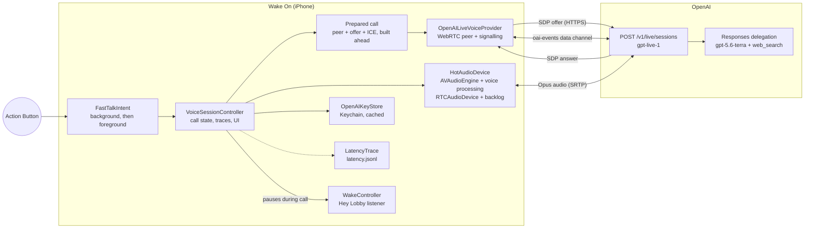

# iOS realtime voice: architecture and latency

Wake On's iPhone app starts a two-way voice conversation with OpenAI's `gpt-live-1.1` (measurements below were taken on `gpt-live-1`) from
the Action Button. The design goal is **trigger → listening**: the time from the press
until the user can speak and be heard, with the app's own overhead as close to zero as iOS
allows. OpenAI's processing time is out of scope; everything on the phone is in scope.

Results, iPhone 17 Pro on Wi-Fi (round trip ≈ 54 ms), Action Button with the fast-start
action:

| | App closed | App in background |
|---|---|---|
| "Listening" on screen (first frame) | ~105 ms | ~60 ms |
| Microphone capturing (speech kept from here) | ~250–370 ms | ~265–300 ms |
| Audio reaching OpenAI (server ready, packets flowing) | ~690–1,380 ms | ~630–950 ms |
| Same, with the normal (non-fast-start) intent | 1,559–1,953 ms | 1,542–1,672 ms |

Starting point for comparison: the first device build, using WebRTC's built-in audio,
reached OpenAI ~1,137 ms after an in-app trigger on a warm call. That is before any
of the iOS hand-off cost an Action Button press adds.

The user sees "Listening" immediately and can start talking within a normal reaction
time. Speech is buffered on the phone until OpenAI is ready. The app's own share of the
network path is ~3–5 ms.

Raw data: [measurements/2026-10-25-ios-voice](measurements/2026-10-25-ios-voice/README.md).
Day-by-day notes: [notebook entry](notebook/2026-10-25-ios-realtime-voice.md).

## Why the API, not a ChatGPT subscription

A ChatGPT plan cannot pay for a third-party app's realtime voice:

- "Sign in with ChatGPT" is limited to approved partners and covers text Responses only.
- Codex voice uses the plan, but only through a desktop host.
- Amp, a launch partner, bills voice to its own credits.

The app therefore calls the API directly with an API key kept in the Keychain. See the
[superseded plan](notebook/2026-10-20-ios-subscription-voice-plan.md).

## Architecture



| Component | File | Role |
|---|---|---|
| `TalkIntent`, `FastTalkIntent`, `EndTalkIntent` | [TalkIntent.swift](../native/ios/WakeOn/TalkIntent.swift) | App Intents for the Action Button. Fast start runs in the background and then calls `continueInForeground`. |
| `VoiceSessionController` | [VoiceSessionController.swift](../native/ios/WakeOn/VoiceSessionController.swift) | Owns one call: fast trigger path, prepared calls, audio arming, server events, turn timing, traces, UI state. |
| `OpenAILiveVoiceProvider` | [OpenAILiveVoiceProvider.swift](../native/ios/WakeOn/OpenAILiveVoiceProvider.swift) | WebRTC peer, SDP offer/answer over `POST /v1/live/sessions`, `oai-events` data channel, statistics sampling, launch warm-up, TLS pre-connect. |
| `HotAudioDevice` | [HotAudioDevice.swift](../native/ios/WakeOn/HotAudioDevice.swift) | The app's own `AVAudioEngine` with voice processing, plugged into WebRTC as an `RTCAudioDevice`. Arms in parallel with the network, buffers microphone audio until the server is ready, then catches up at 4×. |
| `OpenAIKeyStore` | [OpenAIKeyStore.swift](../native/ios/WakeOn/OpenAIKeyStore.swift) | API key in the Keychain, cached in memory. Debug builds adopt `OPENAI_API_KEY` from the launch environment. |
| `TurnTracker`, `AudioActivityDetector` | [VoiceActivity.swift](../native/ios/WakeOn/VoiceActivity.swift) | Speech start and stop from WebRTC's cumulative audio energy (GPT-Live has no speech events). |
| `LatencyTrace` | [LatencyTrace.swift](../native/ios/WakeOn/LatencyTrace.swift) | Monotonic, metadata-only milestone traces in `Documents/latency.jsonl`. |

GPT-Live protocol in brief: the client posts `{session, transport: {type: "webrtc", sdp}}`
with the API key and receives `{session.id, transport.sdp}`. Events arrive on the
`oai-events` data channel: `session.started`, transcript deltas with `start_ms`/`end_ms`,
`session.delegation.created`, `response.event` (the nested Responses stream),
`session.usage.updated` and `session.closed`. There are no speech-started or
audio-started events. Audio cannot be sent over the data channel in WebRTC mode.

## What happens on a press

A fast-start press with the app in the background, final build (times from `perform`):

```text
   0 ms  FastTalkIntent.perform (app still in the background)
         ├─ start local buffering; arm audio deferred (iOS forbids the mic in background)
         ├─ take the prepared call; send its SDP offer          → request at 0.3 ms
         └─ continueInForeground(alwaysConfirm: false)
  ~20    audio session active, kept engine prepared (background)
  ~35    will-enter-foreground → start the microphone early
  ~60    first frame on screen, already showing "Listening"
 ~240    OpenAI answer arrives (server wait ~200–280 ms)
 ~245    answer applied (2 ms; WebRTC never waits on audio)
 ~265–300 microphone capturing; speech now goes into the backlog
 ~400    ICE + DTLS connected (~155 ms, network)
 ~630    session.started (data channel + server, ~230 ms)
         ├─ voice processing switched on
         └─ backlog released, sent at 4× real time, then live audio
 ~780    backlog caught up; the stream is live
```

## How latency is prioritised

1. **Measure every step.** Every stage is a monotonic `DispatchTime` mark. Timestamps are
   taken on the thread where the event happens (WebRTC and audio callbacks), before
   hopping threads. HTTP timing comes from `URLSessionTaskMetrics`. Each call writes a
   setup trace, per-turn traces and probe traces. Every optimisation below was kept
   only after an A/B measurement.
2. **Do the work before the trigger.** The next call's peer connection, SDP offer and ICE
   candidates are built at launch, on becoming active, and after each call. This costs
   nothing and does not touch the microphone. Also done ahead: the API key is cached,
   the TLS connection to `api.openai.com` is opened, and WebRTC runs a throwaway local
   negotiation (including the audio engine) at launch.
3. **Start everything at once at the trigger.** Audio arming and signalling run in
   parallel. The prepared offer is sent synchronously inside the trigger handler, before
   any bookkeeping or UI work.
4. **Never block a critical thread.** The main thread publishes no UI during set-up.
   WebRTC's thread never waits on the audio queue: the device's start calls only flip
   flags, and its parameters are cached because `AVAudioSession` getters block while the
   session is being activated elsewhere.
5. **Hide iOS's own latency.** The fast-start intent runs in the background ~60 ms
   after launch instead of ~700 ms after the app is on screen. The audio session and the
   voice-processing engine are built in the background. The microphone starts at
   will-enter-foreground rather than at active.
6. **Decouple the experience from the network.** "Listening" shows from the first frame.
   Speech is captured locally from the moment the microphone starts and sent once
   OpenAI is ready, so the connection no longer gates when the user can talk.

## Experiments

Times are from the trigger unless noted. "Kept" means the change is in the app.

### Worked

| Change | Before → after | Kept |
|---|---|---|
| Audio session activation on another thread, during the HTTP request | Simulator ready 2,880 → 2,127 ms | Superseded by `HotAudioDevice` |
| Send the offer after 25 ms with no new ICE candidates, instead of at "complete" | Gathering ~105 → ~35 ms; connect unchanged (A/B, four launches) | Yes |
| WebRTC warm-up at launch, including an audio transceiver | Cold `setRemoteDescription` ~190 → ~45 ms | Yes |
| No SwiftUI publishing during set-up; statistics at most twice a second | Fewer main-thread hops; warm `session.started` ~610 ms (simulator) | Yes |
| TLS pre-connect when the app becomes active | Session POST reused HTTP/3 in every run | Yes |
| `HotAudioDevice`: own voice-processing engine, armed at the trigger | Applying the answer ~410–580 → 2–4 ms; reaching OpenAI 1,137 → 726 ms | Yes |
| Restart the engine on its post-start configuration change | Fixed "no microphone packets" in the first hot-device version | Yes |
| Prepared call (peer, offer, ICE before the trigger) | Request sent at 65–89 → 28 ms | Yes |
| Synchronous offer send in the trigger handler, plus key cache | Request at 28 → 0.5 ms; warm reaching OpenAI ~545 ms | Yes |
| Cache audio parameters for WebRTC (no `AVAudioSession` getters) | Applying the answer 12–83 → 2–4 ms | Yes |
| Fast-start intent (`.background` + `continueInForeground`) | First sign of press → reaching OpenAI: 1,559 → ~955 ms (closed), 1,542 → ~917 ms (background) | Yes |
| Build the audio engine and activate the session in the background | Audio ready ~700 → ~510 ms | Yes |
| Start the microphone at will-enter-foreground | Audio ready ~510 → ~295 ms (background) | Yes |
| Local buffering, released at `session.started`, 4× catch-up | Can talk at 309–378 ms instead of 630–1,000 ms; buffered "one, two, three" transcribed | Yes |
| "Listening" from the first frame | Cue at ~60–105 ms (was shown only once connected) | Yes |
| Skip re-activating an already-active session | Removed ~90–105 ms per arm; cold microphone 468 → 248 ms | Yes |
| Shorter filler instruction for delegated questions | Web-searched answer heard 2.9 → 2.1–2.5 s (simulator) | Yes |
| "Always reply" instruction | Replies to counting and statements: 1 of 13 presses → 2 of 2 | Yes |

### Neutral or failed

| Experiment | Result | Outcome |
|---|---|---|
| Normal `openAppWhenRun` intent | iOS runs `perform` ~700 ms after the app is on screen, whether it was closed or in the background | Replaced by fast start; still available as Talk to Lobby |
| Responses delegation off | Server wait within noise of delegation on (simulator) | Delegation stays on |
| Backend reasoning effort `none` vs `low` | No measurable difference over four runs | `low` kept for answer quality |
| WebRTC warm-up without audio | Warm-up 4–20 ms, but no gain on the cold answer | Audio transceiver added (see above) |
| First warm-up with an audio transceiver, racing the call | Deadlock at peer creation | Calls now await the warm-up |
| First `HotAudioDevice` | Engine stopped right after start; re-arming on WebRTC's thread stalled the answer ~1 s, and no audio flowed | Restart-on-change, never build on WebRTC's thread |
| Diagnostic `queue.sync` in the device's start calls | Blocked WebRTC ~55 ms while arming | Removed |
| Re-preparing the kept engine in the background instead of at start | No gain: the early microphone start queues behind it (~80 ms still on the path) | Kept (harmless), no effect |
| `engine.pause()` instead of `stop()` between calls | Microphone live ~287 ms either way (session faster, start slower) | Stop kept: it frees the hardware |
| Voice processing bypassed while buffering | First word captured in later presses; causality unproven (no WAVs for the earlier misses) | Kept: no echo exists before playback |
| `simctl launch --console-pty` for test output | Stalled the app's main thread on `print` | Debug log file in Documents instead |
| Measuring turns in the simulator | The Mac's speakers feed its microphone with no echo cancellation, causing spurious turns | Turn timing measured on the device only |
| Local buffering in the simulator | Mechanics worked; the microphone was too quiet to transcribe | Verified on the device |
| ChatGPT subscription for voice (Sign in with ChatGPT, Codex app-server, private endpoints) | No supported phone-only route | API key |

### Bugs found by measuring

- Applying the answer waited on iOS audio start (~400 ms) inside WebRTC's built-in audio.
- The warm-up's peer close made WebRTC call `stopRecording`, which ended the call's
  buffering until `session.started`. The microphone looked live at 914 ms instead of
  ~300 ms.
- "Live · speak now" was shown at `session.started`, up to ~360 ms before microphone audio
  was flowing. The word "listening" now means capture has started.

## Limits that remain

- **iOS voice-processing start: ~150–180 ms**, plus ~100 ms to re-activate the session on
  an in-app press. Keeping the session or engine running while the app is open would
  remove it, at the cost of stopping other audio and showing the microphone indicator.
  This is a product decision and is not done.
- **Cold launch:** ~67 ms of process launch plus ~98 ms to build the offer, which cannot
  exist before the process does.
- **Network and OpenAI:** server wait 160–1,240 ms (typically ~200 ms), ICE and DTLS
  ~155 ms, data channel and `session.started` ~170 ms. The app cannot reduce these.
- **Spoken reply time** (user stops → reply heard): 938–1,624 ms on the device, almost
  all server-side. It is not measured for the first turn after buffering, because the
  catch-up burst confuses the energy-based turn detector.
- **The microphone starts at about one human reaction time after the first frame**
  (~140–240 ms). Two warm presses had speech starting right as capture began; the word
  was still recognised.

## Reproducing

```sh
cd native/ios && ./scripts/setup.sh        # Sherpa + WebRTC M153
python3 scripts/generate-project.py
```

- Debug launch arguments: `--talk [greeting|search]`, `--end-after <s>`, `--calls <n>`,
  `--no-delegation`, `--no-web-search`, `--effort <level>`, `--ice-quiet <ms>`,
  `--no-warm-audio`, `--builtin-audio`, `--no-prepare`.
- Device logs: `xcrun devicectl device copy from --domain-type appDataContainer
  --domain-identifier com.kamikaz1k.wakeon --source Documents/voice-console.log`.
- Summaries: `scripts/summarize-voice-log.py` (per call, CSV) and
  `scripts/summarize-latency.py` (traces).
